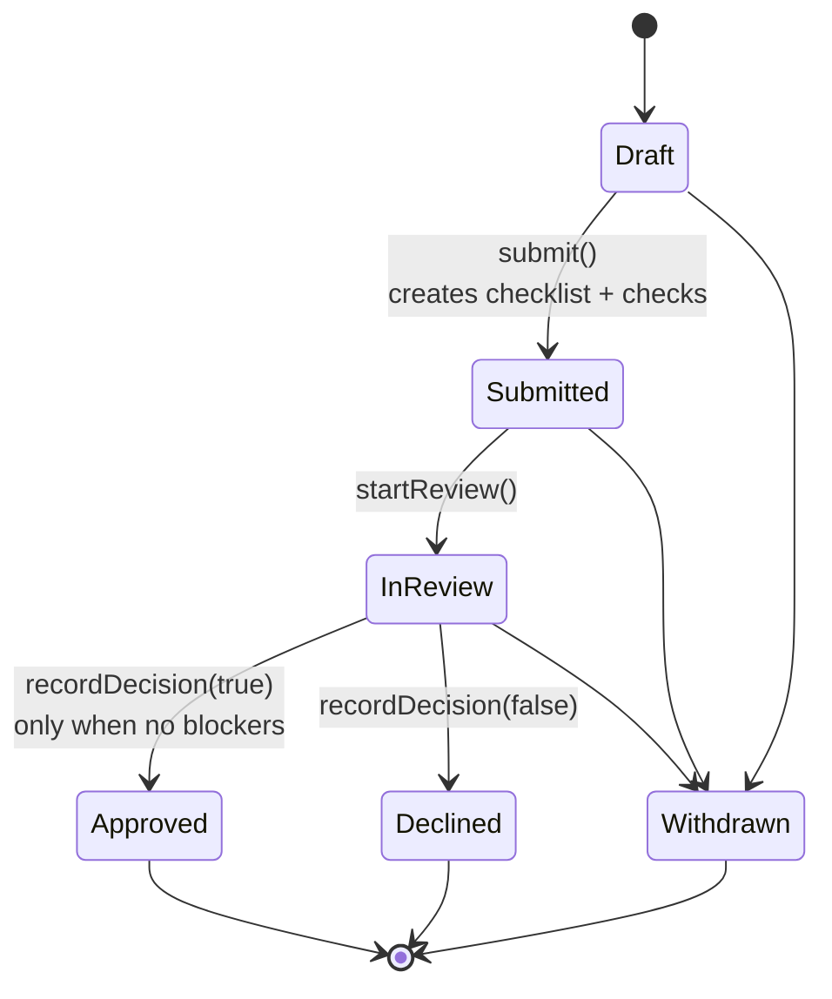
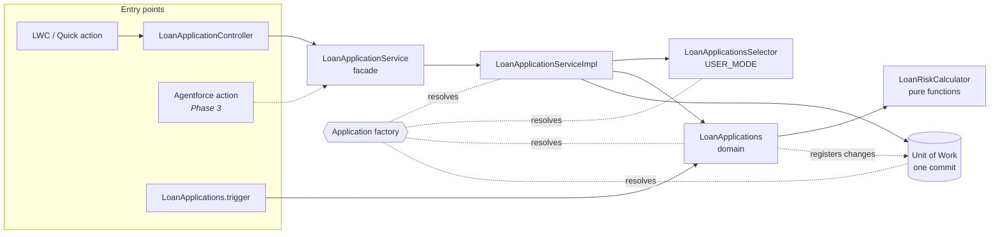
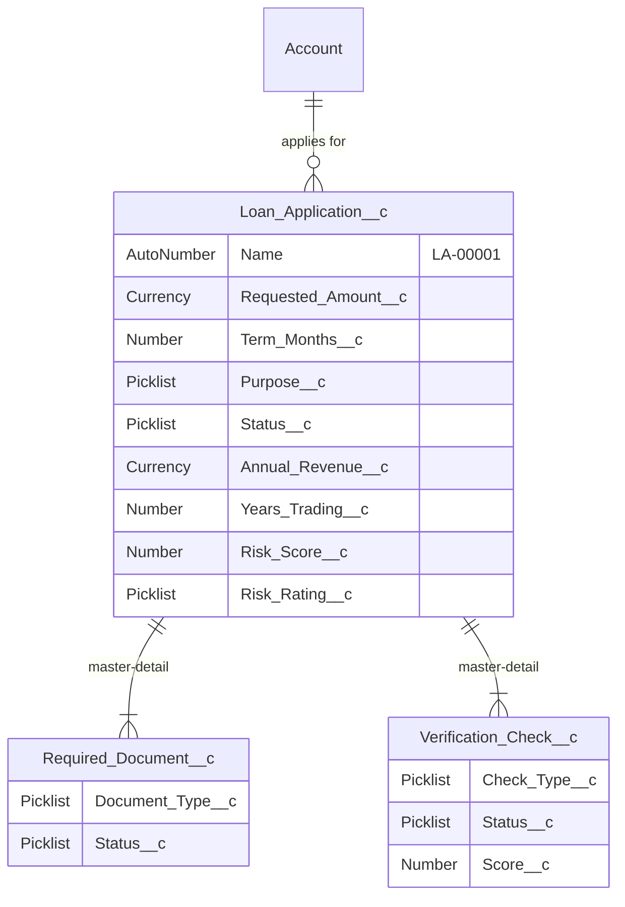

# SME Lending Assistant

An SME lending platform built on Salesforce: loan intake, a purpose-driven document checklist, KYC/AML/credit verification checks, explainable risk scoring and an enforced approval workflow. It is built on **Apex Enterprise Patterns (fflib)** with **ApexMocks** unit tests, **USER_MODE** data access and a **GitHub Actions** pipeline that runs static analysis and deploys to a scratch org on every push.

> **Status:** Phase 1 (core platform) complete. Phase 2 adds event-driven integrations, Phase 3 adds an Agentforce underwriter copilot. See [Roadmap](#roadmap).

---

## What it does

1. A loan officer captures an application for a business (amount, term, purpose, revenue, years trading).
2. A **risk score (0–100)** and **rating** are calculated on every save, using rules simple enough to explain to a customer.
3. On **submit**, the system generates the document checklist for that loan purpose and creates pending **KYC, AML and Credit Bureau** checks.
4. An underwriter moves it **In Review**. The app lists exactly what is blocking approval (unverified documents, failed or missing checks).
5. **Approval is impossible** until every document is verified and every check has passed. Declines are always allowed, and every decision needs notes for the audit trail.
6. A **state machine** in the trigger rejects any status change outside the allowed path, however the update arrives (UI, API, data loader).



## Architecture



| Layer | Class | Responsibility |
|---|---|---|
| Factory | `Application` | Maps interfaces to implementations. Tests swap in mocks with `setMock()`. |
| Service | `LoanApplicationService` / `Impl` | Orchestration only: load → apply domain logic → commit once. No business rules. |
| Domain | `LoanApplications` | All business rules: defaults, validation, state machine, checklist generation, approval blockers. No SOQL or DML. |
| Selector | `LoanApplicationsSelector` | All SOQL, including parent-child subqueries. Runs `WITH USER_MODE`. |
| Pure logic | `LoanRiskCalculator` | Deterministic, explainable scoring. No SObjects, trivially testable. |
| Boundary | `LoanApplicationController` | `@AuraEnabled` wrapper that turns business and DML errors into readable UI messages. |
| Trigger | `LoanApplications.trigger` | One line: delegates to the domain. |

### Data model



## Design decisions

**Why fflib instead of a simple trigger handler?** Separating selector, domain and service makes each piece testable in isolation and keeps the rules in one place no matter who calls them (UI, Flow, API, or an AI agent in Phase 3). The domain never touches the database. It registers work on a Unit of Work, so the service owns the transaction and commits once.

**Why USER_MODE in the selector?** The platform enforces object, field and sharing access for the running user, so there is no hand-written `isAccessible()` checking to forget. `LoanApplicationsSelectorTest.userModeHidesRecordsTheUserCannotSee` proves a lending officer cannot read another officer's private application.

**Why validate status in the trigger, not only in the service?** The service is one way to change status. Data loads, the API and inline edits are others. Enforcing the state machine in the domain's `onValidate` closes every route.

**Why is submit all-or-nothing?** A bulk submit validates every record first and reports every problem in one message, then registers changes. Partial submission of a batch is harder to reason about and harder to support.

**Why a separate risk calculator?** The rules are pure functions, so tests run without any data setup, and the same logic can back an Agentforce action that *explains* a score in Phase 3. The model is deliberately simple. In production it would be replaced by a credit decisioning service, and this class would become the adapter.

## Testing strategy

| Test class | Style | What it proves |
|---|---|---|
| `LoanRiskCalculatorTest` | Pure unit | Every scoring band and boundary |
| `LoanApplicationsTest` | Unit, no DML: fflib `MockDatabase` + ApexMocks Unit of Work + `ArgumentCaptor` | Defaults, validation, state machine, checklist per purpose, idempotent re-submit, approval blockers |
| `LoanApplicationServiceTest` | Unit, selector + domain + UoW all mocked | Orchestration: correct domain call, exactly one commit, no commit on failure |
| `LoanApplicationsSelectorTest` | Integration, runs as Lending Officer | Subqueries and USER_MODE sharing enforcement |
| `LoanApplicationLifecycleTest` | End-to-end, runs as Lending Officer | Draft → Approved, trigger guards, delete rule, **200-record bulk submit with a constant query count** |
| `LoanApplicationControllerTest` | Integration | UI boundary and error translation |

Integration tests run as a Standard User with the `Lending_Officer` permission set, never as the admin, so permission gaps fail in CI rather than in front of a user.

## Getting started

Prerequisites: [Salesforce CLI](https://developer.salesforce.com/tools/salesforcecli) and a Dev Hub (any free Developer Edition org with Dev Hub enabled).

```bash
sf org login web --set-default-dev-hub --alias devhub
./scripts/setup-scratch-org.sh          # creates org, deploys, assigns permset, seeds demo data, runs tests, opens app
```

Or step by step:

```bash
sf org create scratch --definition-file config/project-scratch-def.json --alias sme-lending --set-default --duration-days 7
sf project deploy start
sf org assign permset --name Lending_Officer
sf apex run --file scripts/apex/seed-demo-data.apex
sf apex run test --test-level RunLocalTests --code-coverage --result-format human
```

To deploy to a Developer Edition org or Trailhead Playground instead, log in with `sf org login web --alias dev` and run `sf project deploy start --target-org dev`.

## Continuous integration

`.github/workflows/ci.yml` runs on every push and pull request:

1. **Code Analyzer (PMD)** on `force-app`, failing on High or Critical findings, with the HTML report uploaded as a build artifact.
2. **Scratch org deploy and test**: creates a one-day scratch org, deploys fflib and the app, runs all local tests and fails if any test fails or if coverage of project classes (excluding vendored fflib) is under **90%**. The scratch org is always deleted.

One-time setup: create the repository secret `DEVHUB_SFDX_AUTH_URL`:

```bash
sf org display --target-org devhub --verbose --json | jq -r .result.sfdxAuthUrl
```

Copy the `force://...` value into **GitHub → Settings → Secrets and variables → Actions → New repository secret**.

## Project structure

```
fflib/                     vendored Apex Enterprise Patterns + ApexMocks (BSD-3, licences included)
force-app/main/default/
  classes/                 application, service, domain, selector, controller, tests
  triggers/                LoanApplications.trigger
  objects/                 Loan_Application__c, Required_Document__c, Verification_Check__c
  permissionsets/          Lending_Officer
  applications/, tabs/     SME Lending Lightning app
scripts/                   scratch org setup, demo data, CI result checker
.github/workflows/ci.yml   static analysis + scratch org pipeline
```

## Roadmap

- [x] **Phase 1, core platform:** data model, fflib layers, state machine, risk scoring, ApexMocks tests, CI
- [ ] **Phase 2, event-driven integrations:** Platform Event when an application is submitted; Queueable callouts via Named Credentials to mock KYC/AML and credit bureau services; retry with backoff and a dead-letter record for failures; Change Data Capture feed to an external system
- [ ] **Phase 3, Agentforce:** underwriter copilot that summarises an application, explains the risk score and lists approval blockers (backed by `LoanApplicationService.getApprovalBlockers` and `LoanRiskCalculator`); customer-facing status agent
- [ ] **Phase 4, UI and data:** underwriter dashboard LWC, Experience Cloud applicant portal, optional Data Cloud unified applicant profile

## Licence

Project code: MIT. `fflib/` contains [fflib-apex-common](https://github.com/apex-enterprise-patterns/fflib-apex-common) and [fflib-apex-mocks](https://github.com/apex-enterprise-patterns/fflib-apex-mocks) under their BSD-3-Clause licences.
